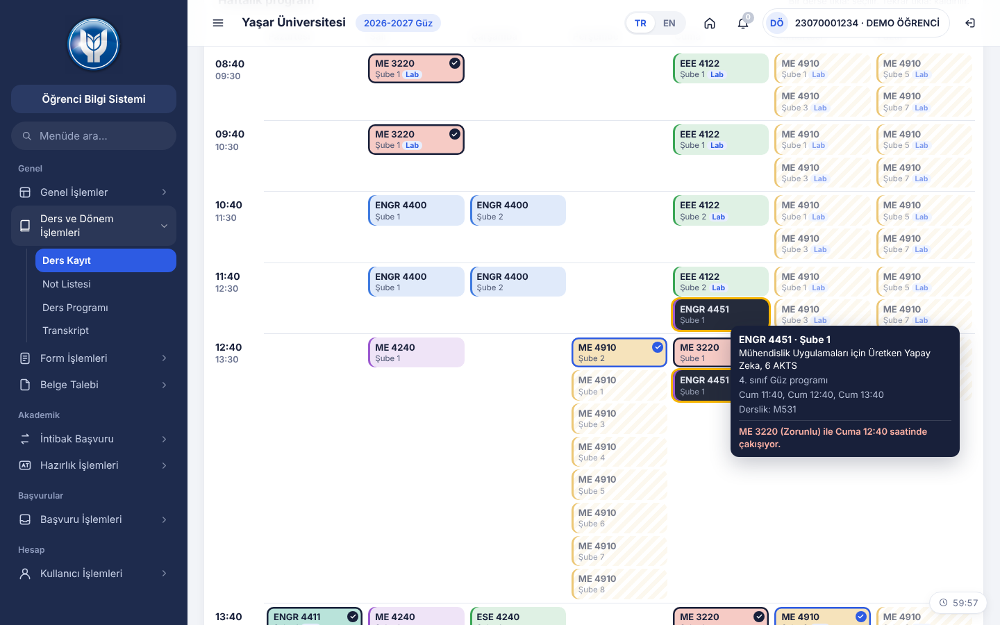
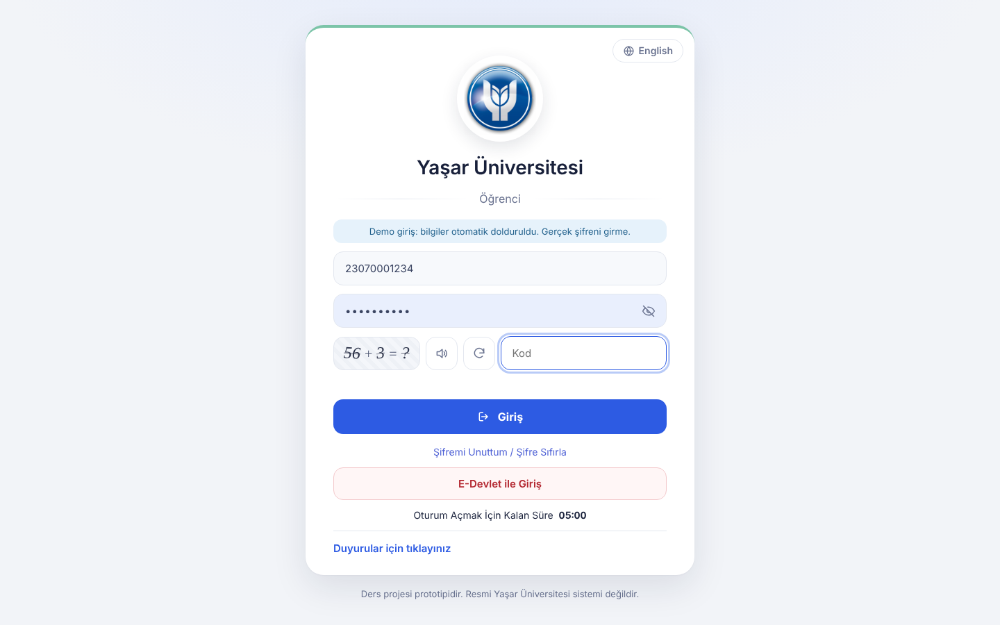
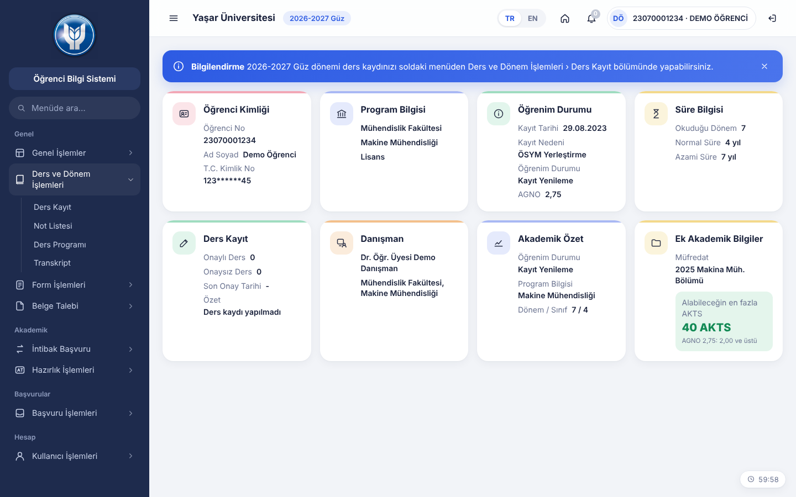
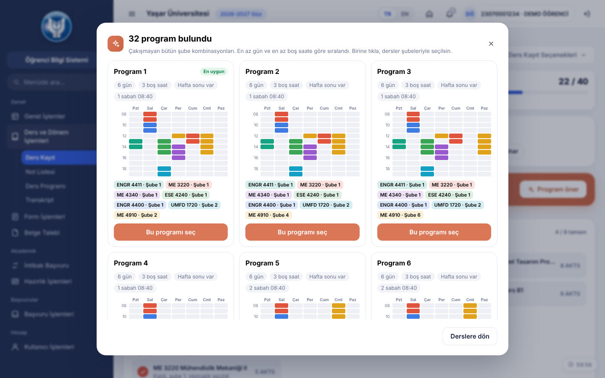
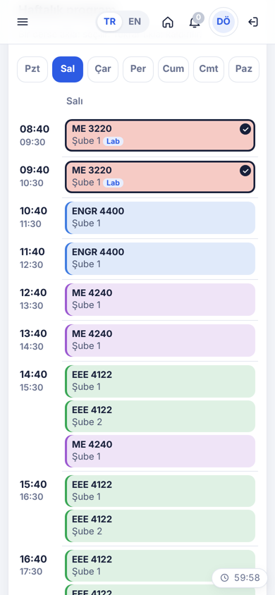

# Ders Kaydı · Haftalık Program

Yaşar Üniversitesi Makine Mühendisliği için ders kayıt ekranı prototipi.

Bugünkü OBS'de dersler düz bir liste hâlinde geliyor ve çakışmayı ancak kayıt sırasında hata alınca öğreniyorsun. Bu prototipte dersleri **haftalık programın üzerinden** seçiyorsun. Çakışan dersler seçmeden önce kilitleniyor ve nedeni yazıyor.

**Canlı site:** https://yarensuudegur.github.io/obs-ders-kaydi/

> Ders projesi prototipidir, resmi Yaşar Üniversitesi sistemi değildir. Giriş bilgileri demo amaçlı otomatik doldurulur; gerçek bir hesapla giriş yapılmaz ve hiçbir bilgi bir yere gönderilmez.

## Özellikler

- **Giriş ekranı:** Demo öğrenci bilgileri hazır gelir, toplama işlemini çözüp giriş yapılır.
- **Ana sayfa:** Öğrenci kimliği, program, öğrenim durumu, AGNO, danışman ve ders kaydı bilgileri.
- **Haftalık program üzerinden seçim:** Bir şubeye tıklamak teorik ve lab saatlerinin hepsini birlikte seçer.
- **Çakışma kilitleri:** Zorunlu dersle çakışan dersler siyah, kendi seçiminle çakışanlar gri. Üzerine gelince sebep yazar.
- **Sınıf ve dönem programları:** 3. ve 4. sınıfın Güz ve Bahar programları ayrı ayrı açılır. Alttan ve üstten ders alınabilir.
- **Öğrenci profili:** Ad, numara, AGNO ve her ders için Geçti / Kaldı / Almadı. Geçilen dersler listeye gelmez, kalınan ve alınmayanlar alttan olarak eklenir.
- **AKTS sınırı:** AGNO 2,00'ın altındaysa 32, 2,00 ve üstündeyse 40 AKTS.
- **Ön koşul:** ME 4920, ME 4910 geçilmeden seçilemez.
- **Yapay zeka önerileri:** Almak istediğin dersleri seç, çakışmayan bütün şube kombinasyonları en az gün ve en az boş saate göre sıralanıp gelsin. Birine tıklayınca dersler şubeleriyle seçilir.
- **Danışman onayı:** Kayıt tamamlanınca demo danışman onaylar, bildirim gelir, program **Ders Programı** sayfasına düşer.
- **PNG indirme:** Seçilen ya da onaylanan program tek tıkla görsel olarak indirilir.
- **Türkçe / İngilizce**, **telefon görünümü** (gün gün program).

| Giriş | Ana sayfa | Program önerisi | Telefon |
|---|---|---|---|
|  |  |  |  |

## Çalıştırma

`index.html` dosyasını tarayıcıda açman yeterli. Kurulum ve internet gerekmez, veriler dosyanın içine gömülüdür.

## Geliştirme

- Kod `src/` klasöründe: `logic.js` (çakışma, kilit, öneri mantığı), `app.js` (arayüz), `i18n.js` (TR/EN metinler), `style.css`, `template.html`.
- Değişiklikten sonra `node build.mjs` ile `index.html` yeniden üretilir.
- Testler: `node --test tests/*.test.js`
- Veriler: `data/mufredat.json` ve `data/program.json`. Bölümün Excel ders programlarından ve müfredat PDF'inden çevrildi; kaynak dosyalar da `data/` içinde.
- Projenin ayrıntılı açıklaması ve kuralları `CLAUDE.md` dosyasında.

## Nasıl yapıldı

Yapay zeka kodlama ajanlarıyla geliştirildi: ilk sürüm Claude'un ajan modunda yazıldı ve test edildi, repo kurulumu ve sonraki adımlar Claude Code ile yapıldı. Proje klasöründeki `CLAUDE.md`, Claude Code'un projeyi tanıması için hazırlandı.

## Bilinen sınırlar

- Sadece 3. ve 4. sınıf (5–8. yarıyıl) programları var.
- Bahar dönemi ders saatleri 2025-2026 Bahar programından alındı.
- Üniversite seçmelileri demo için uydurulmuş derslerdir.
- "Yapay zeka önerileri" bir dil modeli değil, tarayıcıda çalışan kısıt tabanlı bir arama algoritmasıdır.
